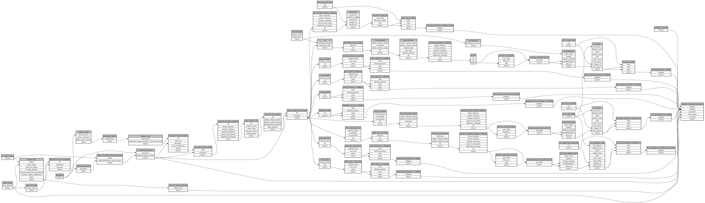

```
# AUTOGENERATED BY ECOSCOPE-WORKFLOWS; see fingerprint in README.md for details

```

```yaml
# fingerprint:
artifacts_sha256_basic: 145cd0ea2601866d019146081caac2fa3bb78d314dedef3e5553daf30eac5ad1
artifacts_sha256_strict: 7243a030d1c8cae1eea22bd44f18df0d197e4d9d94a61163488e005e6ae52879
installed_requirements:
- channel: https://repo.prefix.dev/ecoscope-workflows/
  name: ecoscope-platform
  version: {version: ==2.39.4}
- channel: conda-forge
  name: pydeck
  version: {version: ==0.9.2}
params_sha256: 94606b1bb8c0801b38ed3d4b7ccd13818504ae34b36138538006259eb2803d7a
spec_sha256: 69a346bd96de9362ac458722ea6b7180a6dc7eb6021cfd9be801f1b6b780e503

```

# ecoscope-workflows-subject-tracking-workflow



