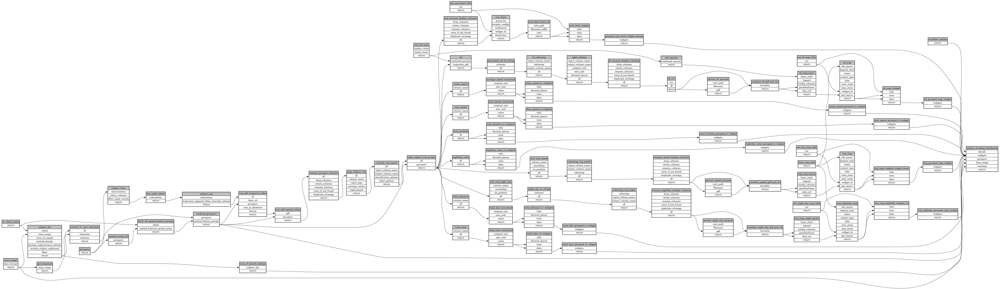

```
# AUTOGENERATED BY ECOSCOPE-WORKFLOWS; see fingerprint in README.md for details

```

```yaml
# fingerprint:
artifacts_sha256_basic: 2a9a9dbd412a5871964e6b8eb10e442143e69357adba4d3470247feb79923108
artifacts_sha256_strict: fdcadd3fc8f99824222c408c5b5b68f548e874a558f6ebe6b1b0bdd6eb6ed556
installed_requirements:
- channel: https://repo.prefix.dev/ecoscope-workflows/
  name: ecoscope-platform
  version: {version: ==2.31.0}
- channel: conda-forge
  name: pydeck
  version: {version: ==0.9.2}
params_sha256: 718e43ae367f2754464e0de951febb524ee940566a52b6205393d31d28c242be
spec_sha256: 9483c3d398c76dfd01a0f53521d8ee671f664c6e25518c53aa3110446f9bcf08

```

# ecoscope-workflows-subject-tracking-workflow



