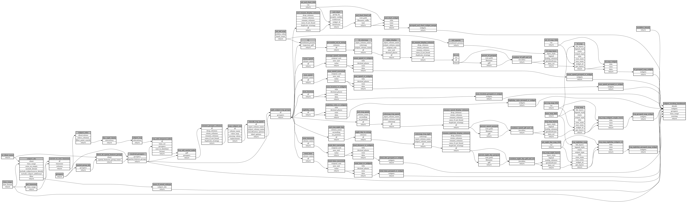

```
# AUTOGENERATED BY ECOSCOPE-WORKFLOWS; see fingerprint in README.md for details

```

```yaml
# fingerprint:
artifacts_sha256_basic: 4da6b3fd7e427f0928297bc6137a86c662aa17543e2a94c2424557d3b080c0d3
artifacts_sha256_strict: 4202f3e1703e4726fde28daed4bb47c898c5f98b3a935feb6d615b76215ad346
installed_requirements:
- channel: https://repo.prefix.dev/ecoscope-workflows/
  name: ecoscope-platform
  version: {version: ==2.26.0}
- channel: conda-forge
  name: pydeck
  version: {version: ==0.9.2}
params_sha256: 59faf653a263ebee6357693eac081eb4ea3f617bf5fe97134728f9e46019f4fd
spec_sha256: 959415dc01405e61903cafc8b5dfadb4b9dbb0bfb571ae3a83b18a8c17e62285

```

# ecoscope-workflows-subject-tracking-workflow


